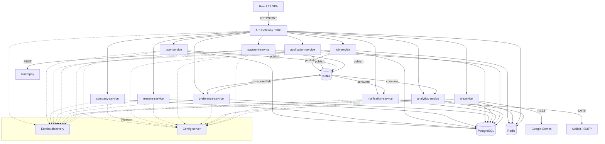

# HireSphere

> AI-powered job portal built with Spring Boot microservices, Kafka, Gemini and React.

[](https://github.com/theshubhamtripathi/hiresphere/actions)


HireSphere is a production-style job platform with three portals — job seeker, employer and admin.
It is built as **ten Spring Boot microservices** behind an API gateway, communicates over **Kafka**
for event-driven workflows, and weaves **Google Gemini** AI through real hiring tasks (resume help,
job descriptions, candidate screening, cover letters and natural-language search). The frontend is a
**React 19** single-page app. Everything runs locally with a single `docker compose up` — no API keys
required (AI falls back to a deterministic mock, email to a local Mailpit inbox).

## Features

### Job seekers
- AI-powered natural-language job search (e.g. *"remote senior java jobs in Bangalore"*).
- Job listing with rich filters, job details and similar jobs.
- Multi-step apply flow: select resume → AI-assisted cover letter → additional info → review.
- Resume builder with work experience, education, skills, projects, certifications, awards and
  languages; live completion score; default resume; AI summary, bullet improvement and resume analysis.
- Saved jobs, job preferences with smart email alerts, application tracking with a status timeline,
  in-app notifications and profile management.

### Employers
- Company profile with onboarding, dashboard with stats and charts.
- Post/edit jobs with **AI-generated descriptions** and **AI skill suggestions**.
- Applications per job with a detail drawer, resume snapshot, private notes and a validated status
  workflow (status changes email the candidate).
- **AI candidate screening** — match score, matched/missing skills and a recommendation.
- Paid plans via **Razorpay** (job credits and featured listings).

### Admins
- Platform dashboard (users, companies, jobs, applications, signup trend, revenue).
- User management (search, filter, enable/disable, delete), company verification/suspension, and
  job metadata management (categories, skills, tags).

### AI features (Gemini, with offline mock)
Resume summary · resume bullet rewriting · resume analysis (ATS score, strengths, gaps, tips) ·
job description generation · skill suggestions · cover-letter generation · candidate screening ·
natural-language → structured job search.

## Architecture



Requests enter through the gateway, which validates the JWT, strips any client-supplied identity
headers and propagates the authenticated user to services via `X-User-Id/Email/Role`. Services trust
those headers and enforce ownership and roles themselves. The gateway also provides Resilience4j
circuit breakers, Redis rate limiting and CORS.

## Services

| Service | Port | Responsibility | Database |
|---|---|---|---|
| api-gateway | 8080 | Routing, JWT, rate limiting, circuit breakers | — |
| discovery-server | 8761 | Eureka service registry | — |
| config-server | 8888 | Centralised configuration | — |
| user-service | 8081 | Auth, users, admin user management | user_db |
| company-service | 8082 | Companies, members, verification | company_db |
| job-service | 8083 | Jobs, categories, skills, tags, search | job_db |
| resume-service | 8084 | Resumes, sections, completion score | resume_db |
| application-service | 8085 | Applications, notes, status workflow | application_db |
| job-preference-service | 8086 | Saved jobs, preferences, alerts | preference_db |
| ai-service | 8087 | Gemini AI features (mock fallback) | ai_db |
| notification-service | 8088 | Emails + in-app notifications | notification_db |
| payment-service | 8089 | Plans, Razorpay, subscriptions | payment_db |
| analytics-service | 8090 | Employer & admin dashboards | analytics_db |

## Event-driven flows

| Topic | Producer | Consumers | Effect |
|---|---|---|---|
| `user.registered` | user-service | notification, analytics | Welcome email; user counters |
| `job.posted` | job-service | preference, analytics | Job alerts; job counters |
| `job.alert` | preference-service | notification | Matching-job email |
| `application.submitted` | application-service | notification, analytics | Confirmation + employer email; counters |
| `application.status-changed` | application-service | notification, analytics | Status email; status distribution |
| `payment.completed` | payment-service | notification, analytics | Receipt email; revenue |

## Tech stack

| Area | Technologies |
|---|---|
| Backend | Java 21, Spring Boot 4.0, Spring Cloud 2025.1 (Eureka, Config, Gateway, Resilience4j, LoadBalancer), Spring Security (JWT via jjwt), Spring Data JPA, PostgreSQL, Flyway, Redis, Spring Kafka, Spring Mail + Thymeleaf, springdoc-openapi, MapStruct, Lombok |
| AI | Google Gemini via REST (`RestClient`) with a deterministic offline mock |
| Frontend | React 19, Vite 7, Redux Toolkit, React Router 7, Axios, Tailwind CSS 4, MUI 7, Formik + Yup, Recharts, react-hot-toast |
| Testing | JUnit 5, Mockito, Testcontainers (PostgreSQL) |
| DevOps | Docker multi-stage builds, Docker Compose, GitHub Actions, Vercel, Caddy |

## Project structure

```
hiresphere/
├── backend/
│   ├── common-lib/            # shared DTOs, exceptions, security context, events
│   ├── infrastructure/        # discovery-server, config-server, api-gateway
│   ├── services/              # the 10 business microservices
│   └── config-repo/           # configuration served by the config server
├── frontend/                  # React 19 SPA
├── docker/                    # postgres init, caddy
├── scripts/smoke-test.sh      # end-to-end smoke test
├── docs/adr/                  # architecture decision records
├── docker-compose.yml         # full local stack
└── DEPLOYMENT.md
```

## Getting started

### Prerequisites
Docker & Docker Compose, plus (for frontend dev) Node.js 22+. JDK 21 and Maven are only needed if you
build outside Docker — the repo ships a Maven wrapper.

### Run the backend
```bash
git clone https://github.com/theshubhamtripathi/hiresphere.git
cd hiresphere
cp .env.example .env            # optional: add GEMINI_API_KEY / Razorpay test keys
docker compose up -d --build    # starts infra + all services + gateway
```

### Run the frontend
```bash
cd frontend
npm ci
npm run dev                     # http://localhost:5173
```

### URLs

| What | URL |
|---|---|
| Frontend | http://localhost:5173 |
| API gateway | http://localhost:8080 |
| Eureka dashboard | http://localhost:8761 |
| Mailpit (emails) | http://localhost:8025 |
| Kafka UI (`--profile tools`) | http://localhost:8100 |
| Swagger (per service) | http://localhost:808x/swagger-ui.html |

### Seeded demo accounts

| Role | Email | Password |
|---|---|---|
| Admin | admin@hiresphere.local | Admin@12345 |
| Employer | employer@hiresphere.local | Employer@123 |
| Job seeker | seeker@hiresphere.local | Seeker@123 |

## Environment variables

| Name | Required | Default | Description |
|---|---|---|---|
| JWT_SECRET | recommended | dev value | HMAC secret for JWTs |
| POSTGRES_USER / POSTGRES_PASSWORD | no | hiresphere | Database credentials |
| GEMINI_API_KEY | no | *(blank)* | Enables real Gemini; mock is used when blank |
| GEMINI_MODEL | no | gemini-2.5-flash | Gemini model id |
| RAZORPAY_KEY_ID / _SECRET / _WEBHOOK_SECRET | no | *(blank)* | Enables payments; endpoints 503 when blank |
| MAIL_HOST / MAIL_PORT / MAIL_FROM | no | mailpit:1025 | SMTP settings |
| ADMIN_EMAIL / ADMIN_PASSWORD | no | admin@hiresphere.local | Seeded admin |
| FRONTEND_URL | no | http://localhost:5173 | Allowed CORS origin |
| VITE_API_BASE_URL | no | *(proxy)* | Frontend → backend base URL |

## API documentation

Each service exposes OpenAPI UI at `http://localhost:<port>/swagger-ui.html` (e.g. user-service on
8081). Through the gateway, all APIs are under `http://localhost:8080/api/...`.

## Testing

```bash
cd backend && ./mvnw -B verify          # unit + Testcontainers integration tests
bash scripts/smoke-test.sh              # end-to-end against a running stack
cd frontend && npm run lint && npm run build
```

Repository and Kafka-backed flows are tested with Testcontainers; the smoke test exercises the full
seeker and employer journey, email delivery, payments and analytics through the gateway.

## Deployment

Backend runs via Docker Compose on a VPS (fronted by Caddy for TLS); the frontend deploys to Vercel.
See [DEPLOYMENT.md](DEPLOYMENT.md).

## Roadmap

- Elasticsearch-backed job search for relevance and typo tolerance.
- WebSocket push for real-time notifications.
- Kubernetes manifests and Helm chart.
- OpenTelemetry tracing with Grafana/Tempo dashboards.
- Resume PDF export and richer AI interview preparation.

## License

MIT — see [LICENSE](LICENSE).

## Author

**Shubham Tripathi** — [github.com/theshubhamtripathi](https://github.com/theshubhamtripathi)
